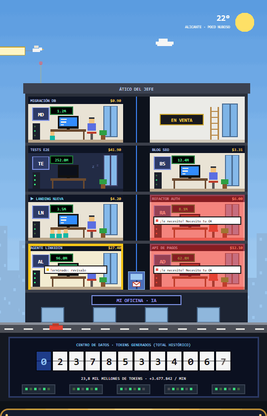
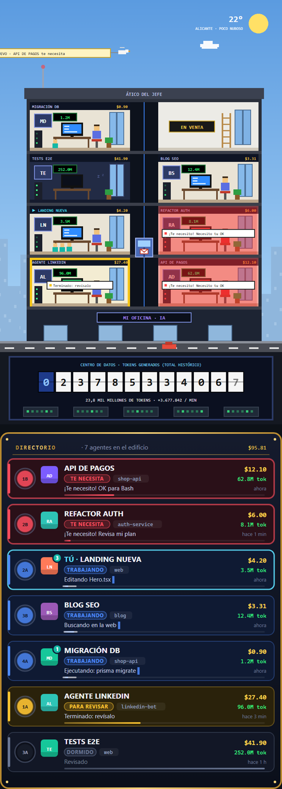
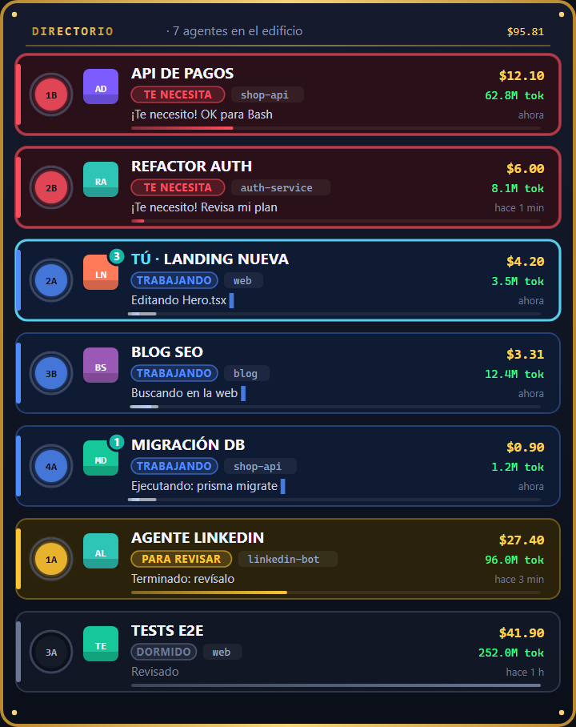
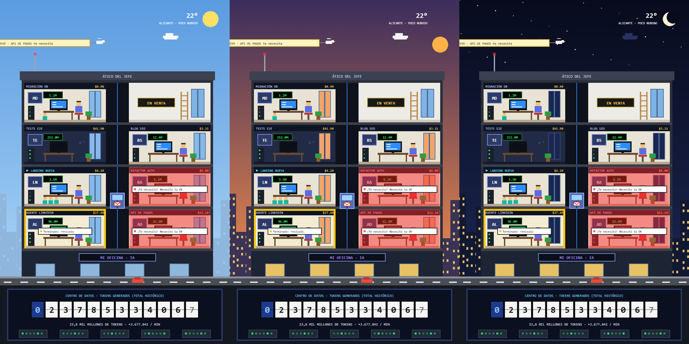

<div align="center">

# 🏢 Mi oficina de agentes de IA

**Un rascacielos pixel-art, al lado de tu chat, donde cada sesión de Claude Code es un piso.**

Mira de un vistazo quién trabaja, quién está atascado, quién te necesita y cuánto gasta cada agente.



[](https://claude.com/claude-code)
[](LICENSE)


[Instalar](#-instalación) · [Qué ves](#-qué-ves) · [Cómo funciona](#%EF%B8%8F-cómo-funciona) · [English](#-english)

</div>

---

## ✨ Qué ves

<table>
<tr>
<td width="50%" valign="top">

### 🔴🟡🔵 Cada piso, un agente

Todas las sesiones de Claude Code de tu ordenador, en la terminal, en la app de escritorio o en worktrees, aparecen como oficinas del edificio:

| | Estado | Qué significa |
|---|---|---|
| 🔴 | **Te necesita** | Espera tu permiso o te ha hecho una pregunta. La oficina parpadea en rojo. |
| 🔵 | **Trabajando** | Monitor escribiendo código, el agente tecleando, LEDs del rack parpadeando. |
| 🟡 | **Para revisar** | Ha terminado y espera a que lo mires. |
| 💤 | **Dormido** | Sin actividad. Luces apagadas y *zzz*. |
| 🏷️ | **En venta** | Plantas libres para nuevos agentes. |

Cada oficina muestra el nombre de la sesión, sus iniciales, el contador de tokens, lo que lleva gastado y, si delega trabajo, sus **subagentes** como mini-ayudantes junto a la mesa.

</td>
<td width="50%" valign="top">



</td>
</tr>
</table>

### 🗂️ El directorio del vestíbulo

Debajo del edificio, un directorio con marco de latón: una tarjeta por agente, **primero los que te necesitan**. Cada tarjeta tiene el botón de ascensor de su planta, su estado, el proyecto, **lo que está haciendo ahora mismo** ("Editando Hero.tsx", "Ejecutando: prisma migrate"…), lo que gasta y su parte del total de tokens.

<div align="center">

</div>

### 🌇 Y todo lo demás

- **🛗 Ascensor:** recorre los pisos de los agentes activos llevando un sobre.
- **🕊️ Paloma mensajera:** cruza el cielo con el último aviso ("API DE PAGOS te necesita").
- **🏭 Centro de datos:** un contador con **todos los tokens que has generado en tu vida** con Claude Code y el ritmo actual en tokens por minuto.
- **🌤️ El tiempo real de tu ciudad**, vía [Open-Meteo](https://open-meteo.com), sin clave.
- **☀️🌆🌙 El cielo sigue la hora de tu ciudad:** de día, al atardecer o de noche con estrellas y ventanas encendidas.

<div align="center">

</div>

---

## 📦 Instalación

Necesitas **Claude Code** y **Node.js** (el escáner de sesiones es un pequeño script de Node).

En una sesión de Claude Code en la terminal, escribe:

```
/plugin install oficina-agentes --marketplace envyx10/oficina-agentes
```

Contesta `y` para añadir el marketplace y elige el alcance **user**, para que salga en todas tus sesiones.

Desde una shell:

```bash
claude plugin install oficina-agentes --marketplace envyx10/oficina-agentes
```

**En la app de escritorio**, donde `/plugin` no está disponible: pulsa **+** junto a la caja del mensaje, luego **Plugins**, **Add marketplace** con `envyx10/oficina-agentes`, y después **Add plugin**.

### Uso

El panel se abre solo al empezar cada sesión. Si lo cierras, vuelve con:

```
/control
```

(también vale `/oficina`).

### ⚙️ Configuración

| Opción | Por defecto | Qué hace |
|---|---|---|
| `city` | `Alicante` | La ciudad del tiempo y del cielo. Cualquier ciudad del mundo: `Madrid`, `Ciudad de México`, `Buenos Aires`… |

Cámbiala desde el menú de configuración de Claude Code (`/config`), o en `~/.claude/settings.json`:

```json
{
  "pluginConfigs": {
    "oficina-agentes": { "options": { "city": "Madrid" } }
  }
}
```

---

## ⚙️ Cómo funciona

```
~/.claude/projects/**/*.jsonl ──► scanner/scan.cjs ──► una línea JSON cada 2 s ──┐
   (transcripciones de todas                (Node, lee solo                        │
    las sesiones y subagentes)               lo nuevo de cada archivo)             ▼
                                                                   hooks/register.tsx ──► panel
~/.claude/oficina-agentes/<sesión>.json ◄── cada sesión con el mod                (SVG animado)
   (estado exacto: ¿espera permiso?)         escribe su propio estado
```

- **Todas las sesiones de tu PC:** el escáner lee las transcripciones que Claude Code guarda en `~/.claude/projects`. De ahí saca el título, lo que está haciendo, los tokens y los subagentes. Lee cada archivo de forma incremental y guarda su progreso en caché, así que es ligero aunque tengas cientos de MB de historial.
- **Estado exacto:** cada sesión que tiene el mod cargado escribe su propio estado (por ejemplo, "esperando tu permiso"), y ese manda sobre lo que se deduce de la transcripción.
- **Sin parpadeos:** el panel solo se redibuja cuando un piso cambia de color o llega o se va un agente; los contadores, como mucho cada 20 s. Todas las animaciones van sincronizadas con el reloj, así que tras un redibujado siguen donde estaban.
- **Coste:** exacto para las sesiones con el mod. Para el resto se estima a partir de los tokens con precios aproximados por modelo.

### Estructura

```
.claude-plugin/
  plugin.json        manifiesto y opción "city"
  marketplace.json   para instalarlo con /plugin install
hooks/
  register.tsx       hooks del mod: estado de la sesión, panel, comandos
  tower.ts           el rascacielos (SVG)
  directory.ts       el directorio del vestíbulo (SVG)
scanner/
  scan.cjs           vigila ~/.claude/projects
types/index.d.ts     contrato de estado del mod
```

### 🔒 Privacidad

Todo se queda en tu máquina. Lo único que sale a internet es la consulta del tiempo a Open-Meteo con el nombre de tu ciudad.

---

## 🌍 English

**My AI agents office:** a pixel-art skyscraper beside your Claude Code chat where **every Claude Code session on your machine is a floor**.

- 🔴 **Needs you:** waiting for your permission or asking a question (blinking red).
- 🔵 **Working:** live activity ("Editing Hero.tsx", "Running: prisma migrate").
- 🟡 **To review:** finished, waiting for you to look.
- 💤 **Sleeping:** idle.

Each office shows the session title, tokens, cost, and its subagents. Below the tower, a lobby **directory** lists every agent, the ones that need you first. Plus an elevator carrying messages, a carrier pigeon with the latest alert, a data center counting **every token you've ever generated**, and real weather with a sky that follows your city's time of day.

**Install** (needs Claude Code and Node.js):

```
/plugin install oficina-agentes --marketplace envyx10/oficina-agentes
```

Open the panel with `/control` (or `/oficina`). Set your city with the `city` option (default `Alicante`). The interface is in Spanish.

It reads the transcripts Claude Code keeps in `~/.claude/projects`, incrementally and locally. The only network call is the weather lookup on Open-Meteo.

---

<div align="center">

Inspirado en la oficina de agentes de [@kodofactory](https://www.tiktok.com/@kodofactory) · Hecho por [@envyx10](https://github.com/envyx10) · [MIT](LICENSE)

</div>
